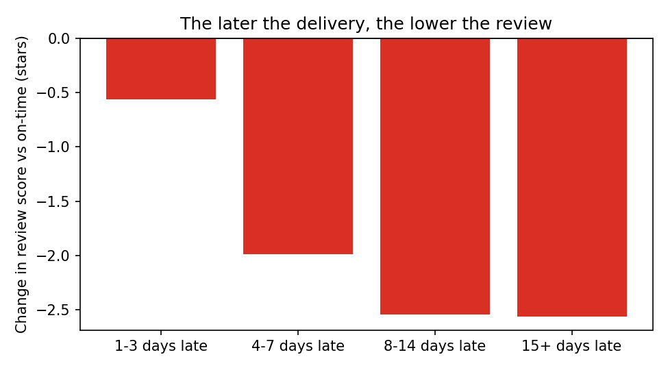

# Enterprise digital twin for business investigation and decision intelligence

A Streamlit dashboard and analysis pipeline that goes beyond reporting *what* happened in an e-commerce business to explain **why**, using prediction, explainable AI and causal inference. It is built on the public Olist (Brazil) dataset of ~96,000 delivered orders.

The goal: let a non-analyst answer questions like *"why are customers unhappy with delivery, and what should we fix?"* in one place, without chasing spreadsheets or asking an analyst.

## What I found

| Question | Answer |
|---|---|
| How common is late delivery? | 8.1% of delivered orders (7,826 of 96,470) |
| Does lateness actually hurt reviews, or are late orders just different? | It hurts. A late delivery causes a drop of about **1.7 stars** (4.29 to 2.57) and raises the chance of a 1-2 star review by roughly **45 percentage points**, even after comparing like with like |
| Does lateness have to be big to matter? | The damage grows with delay: about -0.6 stars at 1-3 days late, about -2.0 at 4-7 days, and about -2.5 beyond 8 days |
| What is behind the late deliveries? | Sellers handing over to the carrier after their deadline (24% of those orders arrive late vs 6.5%, about 27% of all late orders), tight delivery promises, a few regions (Northeast, Rio de Janeiro) and peak months (Nov 2017, Feb-Mar 2018) |
| Can we predict it? | Moderately. See the model results below |



## What's in the dashboard

`app.py` has five analysis tabs (Overview, Products & Sellers, Customers & Geography, Delivery & Reviews, Data & ML Readiness) with filters for date range, order status and customer state.

A separate **Root Cause and Fixes** page (`pages/`) is written for non-analysts and shows:

1. **Naive vs causal view.** The raw late-vs-on-time comparison next to the adjusted one, with a plain-English verdict and the stress tests behind it.
2. **Where lateness comes from.** Seller handover, promise length, regions and peak periods.
3. **What to do about it.** Four actions with evidence and a confidence label, plus a slider that shows the estimated effect (late orders and bad reviews avoided) if a fix only partly works.
4. **Limitations,** stated in plain language.

## How it works

```
Olist CSVs -> data_prep.py -> 01_ml_model.py -> 02_shap_explain.py -> 03_dowhy_causal.py -> dashboard
              one order-level   predict late     explain the          does lateness        reads the saved
              table             deliveries       prediction           cause bad reviews?   results
```

**1. Prediction (`01_ml_model.py`).** Predicts whether an order will be late using only information known at purchase time (distance, promised days, freight, weight, state, product category, season, seller shipping deadline). Delivery dates and review scores are excluded on purpose to avoid data leakage. Random Forest and Hist Gradient Boosting are compared against a do-nothing baseline on both a random split and a time-based split.

| Test ROC-AUC | Random split | Time-based split |
|---|---|---|
| Baseline | 0.500 | 0.500 |
| Random Forest | 0.766 | 0.564 |
| Hist Gradient Boosting | **0.793** | **0.719** |

Checking only the riskiest 20% of orders catches about 59% of late deliveries. About 1 in 5 flagged orders is truly late, so it works as a prioritisation watchlist, not an automatic decision. Accuracy is deliberately not the headline metric: always guessing "on time" scores 92% while catching nothing.

**2. Explanation (`02_shap_explain.py`).** SHAP shows which factors push an order's late risk up or down: short promised windows, long distance, cross-state shipping and peak months raise it. Plots are saved to `outputs/`.

**3. Causal analysis (`03_dowhy_causal.py`).** Uses [DoWhy](https://github.com/py-why/dowhy) to estimate the effect of lateness on review score, adjusting for distance, product category, price, state, season and more. Delay length is deliberately not adjusted for, since it is a consequence of lateness. The result is checked with four refutation tests (random fake confounder, shuffled treatment, data subsets, hidden confounder).

**4. Dashboard.** Reads the saved results, so opening it never retrains anything.

## Run it yourself

```bash
pip install -r requirements.txt
```

1. Download the [Olist Brazilian E-Commerce dataset](https://www.kaggle.com/datasets/olistbr/brazilian-ecommerce) and put the CSV files in `./data/`. Data and trained models are not stored in this repo.
2. Run the pipeline from the project folder, in this order:

```bash
python 01_ml_model.py        # trains models, saves metrics and the model for SHAP (~2 min)
python 02_shap_explain.py    # SHAP plots and tables
python 03_dowhy_causal.py    # causal estimates and stress tests (~4 min)
streamlit run app.py
```

The first dashboard run also builds `data/processed/orders_master.parquet` and `items_master.parquet` (~30 s); later runs are instant. The Root Cause page needs steps 1-3 to have been run first and tells you if something is missing.

## Project structure

```
app.py                     Streamlit dashboard (5 analysis tabs)
data_loader.py             Joins the 9 CSVs into order- and item-level tables for the dashboard
data_prep.py               Builds the modelling table used by the three analysis scripts
01_ml_model.py             Late-delivery prediction, train/test scores
02_shap_explain.py         SHAP explanations
03_dowhy_causal.py         Causal effect of lateness on reviews
root_cause_tab.py          Plain-language "why and what to do" page
pages/                     Streamlit page that loads root_cause_tab
outputs/                   Saved charts and result tables
```

## Limitations

- **Strong evidence, not proof.** The causal estimate adjusts for everything in the data, but unmeasured factors (damaged items, carrier problems, weather) could still play a part.
- **Reviews have other causes too.** Only the score is analysed, not the review text.
- **About two years of data** (2016-2018). Seasonal patterns may be one-off events rather than repeating cycles, and the time-based split shows the model is weaker on future periods than the random split suggests.
- **Impact figures are scenarios.** They assume a fix works as described and ignore side effects such as longer promises reducing sales. The actions overlap, so the numbers should not be added together.
- **Carrier-level information is not in the dataset,** which caps how well lateness can be predicted.

## Tech stack

Python, pandas, NumPy, scikit-learn, SHAP, DoWhy, Plotly, Streamlit.

## Data

[Brazilian E-Commerce Public Dataset by Olist](https://www.kaggle.com/datasets/olistbr/brazilian-ecommerce), released by Olist under CC BY-NC-SA 4.0. All credit for the data belongs to Olist.
